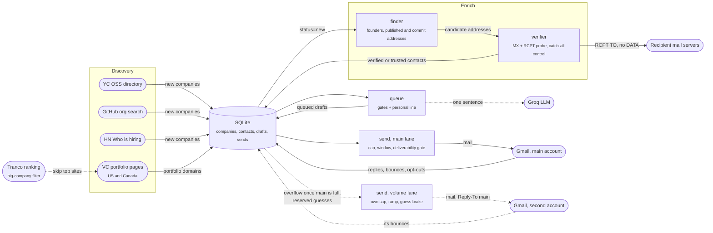
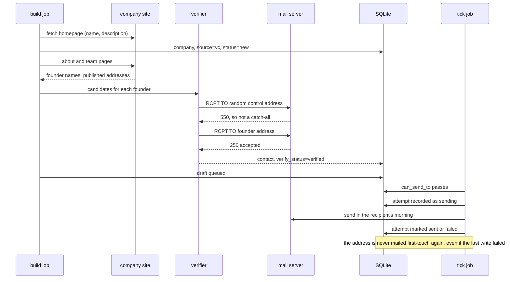

<a id="readme-top"></a>

<!-- PROJECT SHIELDS -->
<div align="center">

[![Contributors][contributors-shield]][contributors-url]
[![Forks][forks-shield]][forks-url]
[![Stargazers][stars-shield]][stars-url]
[![Issues][issues-shield]][issues-url]
[![MIT License][license-shield]][license-url]
[![Latest Release][release-shield]][release-url]
[![Downloads][downloads-shield]][downloads-url]

</div>

<!-- PROJECT LOGO -->
<br />
<div align="center">
  <h3 align="center">Mailbot</h3>

  <p align="center">
    Cold outreach to early-stage startups that finds and verifies real contacts, using only free data sources.
    <br />
    <a href="https://github.com/teddycitrus/mailbot"><strong>Explore the docs »</strong></a>
    <br />
    <br />
    <a href="https://github.com/teddycitrus/mailbot/releases/latest/download/mailbot.exe"><strong>Download for Windows »</strong></a>
    &middot;
    <a href="https://github.com/teddycitrus/mailbot/issues/new?labels=bug">Report Bug</a>
    &middot;
    <a href="https://github.com/teddycitrus/mailbot/issues/new?labels=enhancement">Request Feature</a>
  </p>
</div>

<!-- TABLE OF CONTENTS -->
<details>
  <summary>Table of Contents</summary>
  <ol>
    <li>
      <a href="#about-the-project">About The Project</a>
      <ul>
        <li><a href="#how-it-finds-addresses">How It Finds Addresses</a></li>
        <li><a href="#guardrails">Guardrails</a></li>
        <li><a href="#built-with">Built With</a></li>
      </ul>
    </li>
    <li><a href="#architecture">Architecture</a></li>
    <li>
      <a href="#getting-started">Getting Started</a>
      <ul>
        <li><a href="#prerequisites">Prerequisites</a></li>
        <li><a href="#installation">Installation</a></li>
        <li><a href="#building-from-source">Building From Source</a></li>
      </ul>
    </li>
    <li><a href="#usage">Usage</a></li>
    <li><a href="#configuration">Configuration</a></li>
    <li><a href="#scheduling">Scheduling</a></li>
    <li><a href="#roadmap">Roadmap</a></li>
    <li><a href="#contributing">Contributing</a></li>
    <li><a href="#license">License</a></li>
    <li><a href="#contact">Contact</a></li>
  </ol>
</details>

<!-- ABOUT THE PROJECT -->
## About The Project

Mailbot finds people worth emailing at early-stage startups, works out their
address, checks the address actually exists, writes a personalised note, and
sends a small number of them each morning. It then reads the replies, stops
contacting anyone who asks it to, and drafts an answer to each reply for you to
review and send yourself.

Commercial tools in this space charge for the same pipeline. The expensive part
of those products is not the technique, it is the proprietary contact corpus and
the pool of IP addresses used to verify against. Mailbot builds its own corpus
as it goes and stays deliberately slow, which costs nothing.

It runs entirely on your machine. There is no account, no server, and no
telemetry. Your credentials, your resume and your contact database never leave
the computer you run it on.

<p align="right">(<a href="#readme-top">back to top</a>)</p>

### How It Finds Addresses

Six free sources, in the order they are tried:

| Source | What it gives | Cost |
| --- | --- | --- |
| Y Combinator OSS directory | Companies, location, headcount, batch, hiring flag | No key |
| GitHub org search by city | Companies that never applied to an accelerator | Token |
| US and Canadian VC portfolio pages | Fund-backed companies outside YC (`config/vc_portfolios.txt`) | No key |
| Company website crawl | Any address the company publishes, and founder names from its team page | No key |
| Public git commits | Addresses engineers published in their own commits | Optional token |
| Hacker News "Who is hiring" | Addresses the hiring person typed themselves | No key |

Discovery runs on several sources because one accelerator is not a market. YC's
directory is roughly thirty San Francisco companies for every Toronto one, which
describes YC rather than the cities. GitHub org search is keyed on a
self-reported location, so it reaches companies outside that pipeline and gives
every target city comparable depth. The tradeoff is metadata: a YC record
carries a batch and a team size, a GitHub org carries neither, so the age filter
falls back to the org's creation date and the headcount filter cannot run.
Companies are tagged with the source they came from and stay distinguishable.

VC portfolio pages carry even less: a link and sometimes a name. Each night
reads a rotating slice of about thirty US and Canadian funds. A portfolio also
lists the fund's oldest wins, so any domain inside the top 20,000 sites on the
free Tranco ranking is skipped as a big company, as are companies on a foreign
country domain. With no YC page to name the founders, they are read off the
company's own about and team pages.

When no address is published, one is inferred from the person's name and the
domain's observed naming convention, then confirmed over SMTP: an MX lookup,
then `EHLO`, `MAIL FROM` and `RCPT TO`, closing the connection before `DATA` so
nothing is ever delivered during a check.

Every confirmed address teaches the tool that domain's convention, so guessing
gets more accurate the longer it runs.

There is one honest limit. Many startup domains are catch-alls, which answer
`250 OK` to every recipient including invented ones, so a probe there proves
nothing. So Mailbot sends to an address only when its own mailbox accepted
`RCPT TO` on a domain that refused a random control address, or, on a
catch-all domain, when how it was found is itself the evidence:

| Provenance on a catch-all domain | Sent to? |
| --- | --- |
| The person posted it in an HN "Who is hiring" thread | Yes |
| Published on the site, and the local part fits a named founder | Yes |
| Author address on the company's own git commits | Yes |
| A founder's name in the convention other real addresses there prove | Yes |
| Published on the site but tied to nobody | No (35% bounced) |
| A permutation of a name with no evidence | No |

### Guardrails

This is a cold email tool, so the restraint is the point:

- A hard daily cap, defaulting to a deliberately low number, per sending account
- The main account sends only SMTP-verified addresses, or catch-all ones from a trusted source (table above), follow-ups included. Unprovable catch-all guesses go only from the optional second account, behind its own bounce brake
- An address is contacted at most once, enforced by a unique index and a send log
- Up to three people per company (MAX_CONTACTS_PER_COMPANY), never two on the same day, and nobody else once one of them replies or opts out
- Sends only during the recipient's own local morning, on weekdays
- Replies asking to stop are honoured automatically, before the next send
- Answers to replies are only ever saved as drafts, never sent by the tool
- Bounced addresses are suppressed on the next run
- At most one follow-up, ever
- Nothing is claimed about you except what you list in `config/aspects.txt`

### Built With

* [Python 3](https://www.python.org/) standard library, plus `requests`, `dnspython` and `beautifulsoup4`
* [React](https://react.dev/) and [TypeScript](https://www.typescriptlang.org/)
* [Vite](https://vitejs.dev/), [Tailwind CSS](https://tailwindcss.com/) and [Recharts](https://recharts.org/)
* [SQLite](https://www.sqlite.org/) for local state
* [PyInstaller](https://pyinstaller.org/) for the packaged build

<p align="right">(<a href="#readme-top">back to top</a>)</p>

<!-- ARCHITECTURE -->
## Architecture

Mailbot is one Python program run as separate scheduled jobs that share a
single SQLite file. Discovery fills `companies`, enrichment fills `contacts`,
drafting fills `drafts`, and sending writes the `sends` log that every later
send is checked against.



The second account is optional (`.env.volume`). Both accounts read one
database: nobody is mailed by both, and a reply, opt-out or bounce in either
closes that person, and their company, for both. Each account keeps its own
cap, warmup ramp and bounce brake, read only from its own sends.

One company, from a portfolio page to a sent email:



Every send passes these checks, in order, in `Database.can_send_to`:

1. The address is a person's mailbox, not a shared inbox or a blocked domain.
2. It is not on the suppression list (opt-outs, hard bounces). An opt-out is
   recognised from the person mailed, from anyone answering in our thread,
   and from a colleague writing fresh from the same company domain (never a
   mailing list or a free-mail host). Any of them closes the company.
3. The contact has not already been sent to, replied or bounced.
4. The send log has no earlier successful send to it, nor an attempt whose
   outcome was never recorded. Each send is logged as `sending` before the
   message leaves and updated after, so a failed write cannot cause a repeat.
5. Its `verify_status` is `verified` (the mailbox itself accepted an SMTP RCPT),
   or it is `catchall` with a trusted `provenance`: `hn_post`,
   `founder_published`, `git_commit` or `house_pattern`. When the recent
   bounce rate passes `CATCHALL_STRICT_BOUNCE_PCT` (3%), catch-alls narrow to
   the self-published two (`hn_post`, `founder_published`); past double it,
   no catch-all goes. Held drafts stay queued until the rate recovers.
6. A contact reserved for a lane goes from that lane only. With
   `VOLUME_GUESSES=true`, enrich keeps one first-name guess per founder on a
   catch-all domain (provenance `guess`), reserved for the volume lane; the
   main account never sends one. The volume lane holds them while its recent
   bounce rate is over `GUESS_MAX_BOUNCE_PCT` (6%), or for the rest of the
   day once two or more of today's have bounced over it. A guess that
   hard-bounces disproves that convention at the company: after
   `GUESS_RETRY_AFTER_DAYS` (2) the person gets one retry at the next
   likeliest convention (`guess_retry`), and colleagues still waiting on the
   disproved one are pulled and re-guessed. Two addresses per person at most;
   that bounce closes the company to everything but those retries.

Then the daily cap, the per-company limit (three people, never two on one day,
across both accounts) and the recipient's local send window apply. Follow-ups
go through the same checks in `can_send_to_again`, with only the prior-send
rule relaxed, and always from the account that sent the first message.

How much goes out on a tick: each zone whose window is open gets the share of
the day's remaining cap its drafts make up of everything still reachable today,
divided by the ticks left in that window and rounded up. A zone that opens
later keeps its share; a closed one hands it on. `FOLLOWUP_SHARE_PCT` (33%) of
the cap is kept for follow-ups while any are due, and the volume lane takes an
open draft only after main has used its whole cap that day.

Hard limits: 400 HTTP fetches per run by default, a per-run GitHub call cap,
SMTP probing that gives up after repeated timeouts instead of pushing into a
throttle, and a Tranco download at most once a week.

<p align="right">(<a href="#readme-top">back to top</a>)</p>

<!-- GETTING STARTED -->
## Getting Started

### Prerequisites

* A mail account you can create an app password for. Gmail needs two-factor
  authentication enabled first.
* Your resume as a PDF. The filename travels with the email, so name it
  after yourself rather than leaving it as resume.pdf.
* Nothing else. Both API integrations are optional and both have free tiers.

### Installation

Download the latest build:

    https://github.com/teddycitrus/mailbot/releases/latest/download/mailbot.exe

That link always serves the newest release, so it is safe to bookmark or share.
Every version is also listed on the
[releases page](https://github.com/teddycitrus/mailbot/releases).

Put the executable in a folder of its own and run it. The console opens in your
browser and walks you through setup.

Windows will warn that the publisher is unrecognised, because the build is not
code signed. Choose "More info" and then "Run anyway" if you are willing to
trust it, or build it yourself from source using the steps below.

The executable creates its configuration, database and resume folder beside
itself. Keep it in its own directory rather than a shared Downloads folder.

### Building From Source

```sh
git clone https://github.com/teddycitrus/mailbot.git
cd mailbot
pip install -r requirements.txt

cd dashboard && npm install && npm run build && cd ..
python -m dash
```

To produce the executable:

```sh
powershell -ExecutionPolicy Bypass -File scripts\build_exe.ps1
python -m src.main verify-build
```

`verify-build` scans the finished binary for your credentials, your email
address, your resume and your contact database, and refuses to pass if it finds
any of them. Run it before publishing a build.

<p align="right">(<a href="#readme-top">back to top</a>)</p>

<!-- USAGE -->
## Usage

The console is the intended interface. On first run it shows a setup checklist;
once the required steps are done it becomes a progress dashboard with reply
rates, bounce rates, queue depth and the full contact table.

Every stage is also a command, which is what the scheduled jobs call:

```sh
python -m dash                    # setup and progress console
                                  # (same as: python -m src.main dashboard)
python -m src.main discover       # find qualifying companies (Y Combinator)
python -m src.main gh             # find companies via GitHub org search
python -m src.main vc             # find companies on US and Canadian VC portfolio pages
python -m src.main hn             # import the Hacker News hiring threads
python -m src.main priority       # seed the companies named in config/priority.txt
python -m src.main enrich         # find and verify a contact at each company
python -m src.main queue          # render personalised drafts
python -m src.main mirror         # copy queued drafts into Gmail Drafts
python -m src.main preview        # read the drafts before anything is sent
python -m src.main send           # send, respecting cap and window
python -m src.main followup       # one nudge to people who never replied
python -m src.main inbox          # scan for bounces, replies and opt-outs, draft answers,
                                  # and bin the bounce notices for people it mailed
python -m src.main digest         # email yourself a weekly summary
python -m src.main doctor         # check everything the scheduled jobs rely on
python -m src.main health         # same checks, but email you if any of them fail
python -m src.main bounce-report  # email you if the day's bounce rate went over
python -m src.main reverify       # re-probe contacts whose verdict was a failed probe
python -m src.main import-apollo export.csv   # load an Apollo export (--dry-run first)
python -m src.main reopen-catchall             # re-enrich parked catch-all companies
python -m src.main retry-guesses               # next permutation after a guess bounced
python -m src.main --lane volume send          # act as the second account
```

`--lane volume` reads `.env.volume` over `.env` and accepts only the sending
side: `send`, `followup`, `inbox`, `health`, `doctor`, `bounce-report`,
`stats` and `preview`. Finding, drafting and the Drafts mirror run once, on
main, for both accounts.

Sending stays off until you set `DRY_RUN=false`. Run `preview` first and read
what it is about to send in your name.

<p align="right">(<a href="#readme-top">back to top</a>)</p>

<!-- CONFIGURATION -->
## Configuration

The console writes these for you. They live in `.env` beside the executable and
are never committed or bundled.

| Key | Default | Notes |
| --- | --- | --- |
| `FROM_NAME`, `FROM_EMAIL` | none | Your identity. Reply-to and unsubscribe derive from these |
| `SMTP_PASS`, `IMAP_PASS` | none | App password, not your account password |
| `DAILY_SEND_LIMIT` | `10` | A personal address should stay well under this kind of volume |
| `SEND_WINDOW_START`, `SEND_WINDOW_END` | `08:30`, `10:00` | Local to each recipient |
| `PER_RECIPIENT_TIMEZONE` | `true` | Send during their morning, not yours |
| `MIN_CONFIDENCE` | `70` | Below this an address is never queued |
| `QUEUE_TARGET` | `60` | How many finished drafts to keep waiting |
| `MIRROR_TO_DRAFTS` | `true` | Copy queued drafts to Gmail Drafts as a fallback |
| `PRIORITY_PATH` | `config/priority.txt` | Companies that skip the gates and go first |
| `VC_PORTFOLIOS_PATH` | `config/vc_portfolios.txt` | Fund portfolio pages, one `fund, country, url` line each |
| `VC_MAX_SITE_RANK` | `20000` | Portfolio domains ranked inside this on Tranco are skipped as big companies |
| `TARGET_LOCATIONS` | `San Francisco,New York,Toronto` | Comma separated |
| `MAX_EMPLOYEES`, `MAX_COMPANY_AGE_YEARS` | `200`, `5` | Target filter |
| `PREFER_RECENTLY_FUNDED` | `true` | Rank by recency of funding blended with ability to hire |
| `FOLLOWUP_AFTER_DAYS` | `6` | Set `FOLLOWUP_ENABLED=false` to disable entirely |
| `FOLLOWUP_SHARE_PCT` | `33` | Share of the daily cap kept for follow-ups while any are due |
| `SEND_TICK_MINUTES` | `15` | How often the send timer fires; the cap is spread over the ticks left |
| `ALERT_TO` | `FROM_EMAIL` | Where health and bounce alerts go |
| `VOLUME_GUESSES` | `false` | Keep catch-all first-name guesses for the second account |
| `GUESS_MAX_BOUNCE_PCT` | `6` | The second account's brake on those guesses |
| `GUESS_RETRY_AFTER_DAYS` | `2` | Wait before a bounced guess gets its one retry |
| `GROQ_API_KEY` | none | Optional. Writes one tailored sentence per email |
| `GITHUB_TOKEN` | none | Optional. Raises the API limit from 60 to 5000 per hour |
| `DRY_RUN` | `true` | Nothing is sent until this is false |

Three files hold your own words:

* `config/template.txt` is the email. The first line must start with `Subject:`.
* `config/reply.txt` is optional. When it exists, every person who replies gets
  an answer drafted from it, threaded under their message and saved to your
  Drafts folder over IMAP. Nothing is sent; you review each draft and send it
  yourself. One draft per person, and out-of-office replies are skipped. Write
  links as `[label](url)` to make them clickable. Delete the file to turn
  drafting off. See `config/reply.example.txt`.
* `config/aspects.txt` lists what you have actually built, one short phrase per
  line. The generated sentence may only draw on this list, so it cannot invent
  experience you do not have. An empty file means that sentence is left out.

<p align="right">(<a href="#readme-top">back to top</a>)</p>

<!-- SCHEDULING -->
## Scheduling

```sh
powershell -ExecutionPolicy Bypass -File scripts\install_schedule.ps1
```

Registers seven Windows tasks:

| Task | When | What |
| --- | --- | --- |
| `mailbot-health` | Every day 07:45 | Check everything, alert if anything is broken |
| `mailbot-draft` | Every day, 06:00 to 23:00, every 2h | Render drafts, copy them to Gmail Drafts |
| `mailbot-prep` | Weekdays 08:25 | Full mailbox scan before the window opens |
| `mailbot-send` | Weekdays 08:30 to 13:30, every 15m | Send each window's share of the day's cap |
| `mailbot-bounce` | Weekdays 13:45 | Judge the day's bounce rate, alert if over |
| `mailbot-build` | Every day 19:30 | Discover and enrich new companies |
| `mailbot-digest` | Fridays 17:00 | Email you a weekly summary |

The split that matters is drafting from sending. Drafting has no deadline, so
it runs whenever the machine happens to be on and stops as soon as
`QUEUE_TARGET` drafts are waiting. Sending is the only job that has to land in
a particular hour, and it now does nothing but send what is already written.

That ordering is the fix for a real failure. Drafting used to happen at 08:25
on weekdays, so a laptop asleep at 08:25 produced no drafts, and a laptop
asleep until 10:25 also missed every send tick before then. One closed lid
cost the whole day.

Only one job runs at a time. They overlap on the hour and both wake triggers
fire at the same instant, so each takes a lock beside the database; a job that
cannot get it says so and exits, because every one of them runs again soon.
Without it, two `mirror` passes could put two copies of the same draft in
Gmail, and only one would be cleared after sending.

### Knowing when it breaks

Everything here fails silently. The check that matters most is `verification`,
which reads the verdicts themselves: a verdict of "no SMTP answer" records a
probe that never completed, not a fact about a mailbox, and a pool made mostly
of those means address verification has stopped working while every other
check still looks healthy. That is not hypothetical. It ran that way for weeks,
capping good addresses at guessed confidence and filing reachable companies as
unreachable, and nothing said a word.

`mailbot-health` runs before the first window opens and announces a failure
three ways, because the thing being reported on may be the thing that is
broken: an email, a desktop notification raised from the exit code, and
`logs/ALERT.txt` on disk.

The same run checks the warmup ramp. A day held at `SEND_RAMP_START` by the
bounce brake is a warning; three send days in a row is a failure and an
email, because from 2026-10-21 the cap sat at the floor for two weeks while
every check said all good. It also fails on a weekday that sent nothing while
drafts waited, and on a week that added fewer sendable named people than one
day's `DAILY_SEND_LIMIT`, since a broken parser shows up as a trickle rather
than an error.

`mailbot-bounce` runs fifteen minutes after the last send tick and judges the
day on its own. The warmup ramp already brakes on bounces, but it reads the
last hundred sends and counts only bounces whose class of address the gates
would still mail (a bounce from a class they now refuse cannot recur): two
bounces in twenty-one is 9.5% for the day and moves a hundred-send average by
two points, so the brake stays off and a bad morning looks identical to a
good one. This daily check counts every bounce whatever its class, because
the question is whether today went wrong. It mails you when a single day crosses
`DAILY_BOUNCE_ALERT_PCT`, and names what each bounced address was believed to
be worth when it was drafted, because a verdict reading "no SMTP answer" means
that address was never actually proved. Once probing is healthy again, `mailbot reverify`
re-probes everything whose verdict was a failed probe, suppresses any address
that turns out to be dead, and puts companies parked during the outage back in
the enrich queue. It never touches anyone who has already been written to.

Enrichment stays separate for its own reason: it makes slow calls to third
parties, and a single hung request should never eat the send window.

Each tick only contacts people whose local window is currently open, so the
08:30 to 13:30 span covers Eastern recipients in their morning and then
Pacific ones in theirs. Ticks when nobody's window is open simply send
nothing.

### If the laptop is gone

With `MIRROR_TO_DRAFTS=true` every queued draft also sits in your Gmail Drafts
folder, personalised and carrying the resume. If the machine is closed all
day, open Gmail on a phone and send them by hand.

Nothing goes out twice. The bot deletes its copy the moment SMTP accepts a
message, and reads the Sent folder before every send run, so a draft you sent
yourself is recorded and dropped from the queue before the scheduled run
reaches it. An unfinished draft is never mirrored at all, because a copy in
Drafts is something a human can send without passing the checks `send` makes.

### Priority companies

`config/priority.txt` is a hand-written list of companies to put at the front.
They skip the team-size, age and location gates, and are enriched, drafted and
sent before anything else. Nothing about sending is relaxed: they still need a
verified contact and still obey the cap, the window and the suppression list.

```sh
python -m src.main priority --resolve
```

resolves a domain for any entry that has none and writes it back to the file.
It only accepts a guessed domain when the site serving it names the company,
and reports the rest for you to fill in by hand. Mailing a stranger who
happens to own the `.com` is worse than missing a company.

<p align="right">(<a href="#readme-top">back to top</a>)</p>

<!-- ROADMAP -->
## Roadmap

- [x] Free discovery, enrichment and SMTP verification
- [x] Per-domain address pattern learning
- [x] Recipient-local send windows
- [x] Reply, bounce and opt-out handling
- [x] Drafted answers to replies, left for you to send
- [x] Setup and progress console
- [x] Packaged Windows build
- [ ] macOS and Linux builds
- [ ] Funding signal keyed on domain rather than company name
- [ ] Headcount growth as a ranking input, once enough history accumulates
- [x] Discovery sources beyond Y Combinator
- [ ] City startup directories, for cities GitHub and YC both under-serve

See the [open issues](https://github.com/teddycitrus/mailbot/issues) for the
full list.

<p align="right">(<a href="#readme-top">back to top</a>)</p>

<!-- CONTRIBUTING -->
## Contributing

Contributions are welcome. Fork the repo, create a feature branch, and open a
pull request.

```sh
git checkout -b feature/your-feature
git commit -m "Add your feature"
git push origin feature/your-feature
```

Please run the tests first:

```sh
python -m pytest tests/ -q
```

If you add a discovery source, keep it free and keep it polite: honour
robots.txt, rate limit it, and cap the calls it can make in one run.

> **Disclaimer:** This tool sends unsolicited email. That is legal in most
> places when the message is genuine, identifies you, and offers a way to opt
> out, all of which it does by default. It is your responsibility to know the
> rules where you and your recipients live, including CAN-SPAM, CASL and GDPR.
> Do not raise the daily limit to a number a human could not plausibly write by
> hand, and do not remove the opt-out handling.

<p align="right">(<a href="#readme-top">back to top</a>)</p>

<!-- LICENSE -->
## License

Distributed under the MIT License. See `LICENSE` for more information.

<p align="right">(<a href="#readme-top">back to top</a>)</p>

<!-- CONTACT -->
## Contact

Project Link: [https://github.com/teddycitrus/mailbot](https://github.com/teddycitrus/mailbot)

<p align="right">(<a href="#readme-top">back to top</a>)</p>

<!-- MARKDOWN LINKS & BADGES -->
[contributors-shield]: https://img.shields.io/github/contributors/teddycitrus/mailbot.svg?style=for-the-badge
[contributors-url]: https://github.com/teddycitrus/mailbot/graphs/contributors
[forks-shield]: https://img.shields.io/github/forks/teddycitrus/mailbot.svg?style=for-the-badge
[forks-url]: https://github.com/teddycitrus/mailbot/network/members
[stars-shield]: https://img.shields.io/github/stars/teddycitrus/mailbot.svg?style=for-the-badge
[stars-url]: https://github.com/teddycitrus/mailbot/stargazers
[issues-shield]: https://img.shields.io/github/issues/teddycitrus/mailbot.svg?style=for-the-badge
[issues-url]: https://github.com/teddycitrus/mailbot/issues
[license-shield]: https://img.shields.io/github/license/teddycitrus/mailbot.svg?style=for-the-badge
[license-url]: https://github.com/teddycitrus/mailbot/blob/main/LICENSE
[release-shield]: https://img.shields.io/github/v/release/teddycitrus/mailbot.svg?style=for-the-badge
[release-url]: https://github.com/teddycitrus/mailbot/releases/latest
[downloads-shield]: https://img.shields.io/github/downloads/teddycitrus/mailbot/total.svg?style=for-the-badge
[downloads-url]: https://github.com/teddycitrus/mailbot/releases
